<div align="center">


# Pulse

**Voyez ce que fait votre ordinateur, et réglez le problème quand il ralentit.**

Gratuit · Linux et Windows · Sans pub, sans compte, sans collecte de données

[English](README.md) · [Installer](#installation) · [Téléchargements](https://github.com/tfem1/pulse/releases)

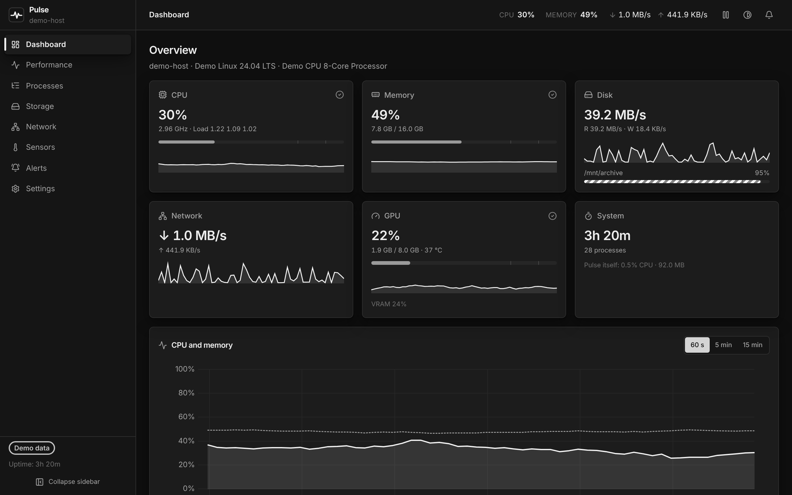

</div>

## À quoi sert Pulse ?

Pulse est un **moniteur système** : une application qui montre, en direct, comment
votre ordinateur utilise ses ressources. C'est comme le Gestionnaire des tâches de
Windows, mais plus clair, plus complet, et ça marche aussi sous Linux.

Utilisez-le quand :

- **Votre ordinateur rame.** Pulse montre quel programme utilise le processeur
  ou la mémoire, et vous pouvez le fermer en un clic.
- **Votre disque est plein.** Pulse montre l'espace restant et trouve les dossiers
  qui prennent le plus de place.
- **Votre ordinateur chauffe ou le ventilateur fait du bruit.** Pulse affiche les
  températures et la vitesse des ventilateurs.
- **Internet vous semble lent.** Pulse montre ce que chaque connexion réseau
  télécharge et envoie en ce moment.
- **Vous voulez être prévenu.** Pulse peut vous envoyer une notification, par
  exemple quand la mémoire est presque pleine ou que le processeur reste à 100 %
  trop longtemps. Cela continue de fonctionner quand la fenêtre est fermée.

## Installation

### Linux

1. Ouvrez un **Terminal** (cherchez « Terminal » dans le menu des applications).
2. Collez cette commande et appuyez sur <kbd>Entrée</kbd> :

   ```bash
   curl -fsSL https://raw.githubusercontent.com/tfem1/pulse/main/install.sh | sh
   ```

3. Si votre mot de passe est demandé, tapez-le (rien ne s'affiche pendant la
   saisie, c'est normal) et appuyez sur <kbd>Entrée</kbd>.

Pulse est maintenant dans votre menu des applications.

### Windows

1. Ouvrez **PowerShell** : clic droit sur le bouton Démarrer, puis _Terminal_ ou
   _Windows PowerShell_.
2. Collez cette commande et appuyez sur <kbd>Entrée</kbd> :

   ```powershell
   irm https://raw.githubusercontent.com/tfem1/pulse/main/install.ps1 | iex
   ```

Pulse est maintenant dans le menu Démarrer. Pas besoin de droits administrateur.

### Vous préférez un installateur classique ?

Téléchargez le fichier de votre système sur la
[page des téléchargements](https://github.com/tfem1/pulse/releases) :

- **Windows :** le fichier qui se termine par `-setup.exe`
- **Ubuntu, Debian, Mint :** le fichier `.deb` (double-cliquez dessus)
- **Autres Linux :** le fichier `.AppImage` (clic droit → Propriétés → autoriser
  l'exécution, puis double-clic)

### Désinstaller

- **Linux :**

  ```bash
  curl -fsSL https://raw.githubusercontent.com/tfem1/pulse/main/install.sh | sh -s -- --uninstall
  ```

- **Windows :** _Paramètres → Applications → Pulse → Désinstaller_.

## Ce que vous trouverez dans Pulse

| Page                | Ce qu'elle montre                                                                                                                                                                                                                                                                                       |
| ------------------- | ------------------------------------------------------------------------------------------------------------------------------------------------------------------------------------------------------------------------------------------------------------------------------------------------------- |
| **Tableau de bord** | Tout en un coup d'œil : processeur, mémoire, disque, réseau, carte graphique.                                                                                                                                                                                                                           |
| **Performances**    | Des graphiques détaillés sur la dernière minute, 5 minutes ou 15 minutes.                                                                                                                                                                                                                               |
| **Processus**       | Comme le Gestionnaire des tâches : la vue **Applications** liste vos applications ouvertes (tous les processus d'une application regroupés) avec un bouton **Terminer** ; les vues **Liste** et **Arbre** montrent chaque processus. Chercher, trier, fermer, mettre en pause ou ralentir un programme. |
| **Stockage**        | L'espace utilisé sur chaque disque, et les plus gros dossiers.                                                                                                                                                                                                                                          |
| **Réseau**          | La vitesse de réception et d'envoi de chaque connexion.                                                                                                                                                                                                                                                 |
| **Capteurs**        | Températures, vitesse des ventilateurs et tensions.                                                                                                                                                                                                                                                     |
| **Alertes**         | Vos règles d'avertissement, par exemple « préviens-moi si la mémoire dépasse 90 % ».                                                                                                                                                                                                                    |
| **Paramètres**      | Thème, langue (français / anglais), vitesse de rafraîchissement, notifications, export des données.                                                                                                                                                                                                     |

**Quelques astuces :**

- Dans **Processus → Applications**, cliquez sur **Terminer** à côté d'une
  application pour la fermer. Pulse lui demande de se fermer, comme sa propre
  croix, puis l'arrête au bout de 5 secondes si elle ne répond pas. **Forcer la
  fermeture** la ferme immédiatement, par exemple si elle est bloquée. Faites un
  clic droit pour plus d'options. Les vues **Liste** et **Arbre** gèrent chaque
  processus.
- Le bouton **Pause** de la barre du haut fige les graphiques pour les lire
  tranquillement.
- Quand vous fermez la fenêtre, Pulse continue de tourner dans le coin de la
  barre des tâches (la zone de notification), pour que vos alertes continuent de
  fonctionner. Pour le quitter complètement, faites un clic droit sur son icône
  et choisissez **Quit Pulse**.
- Raccourcis clavier : <kbd>Ctrl</kbd>+<kbd>1</kbd> à <kbd>8</kbd> pour changer
  de page, et <kbd>/</kbd> pour chercher dans la liste des processus.

La langue de l'application suit celle de votre système ; vous pouvez la changer
dans _Paramètres → Apparence_.

## Captures d'écran

| Processus                                    | Performances                                                         |
| -------------------------------------------- | -------------------------------------------------------------------- |
| 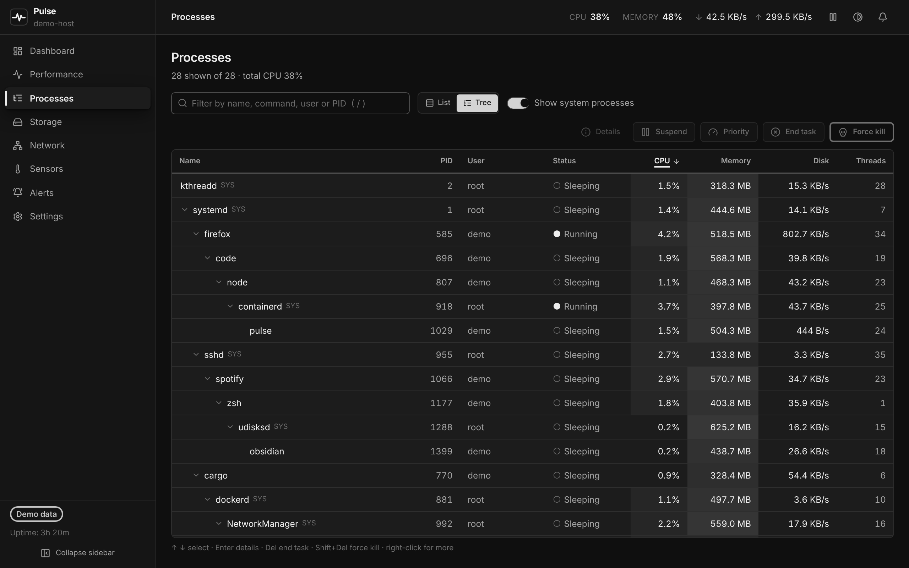 | 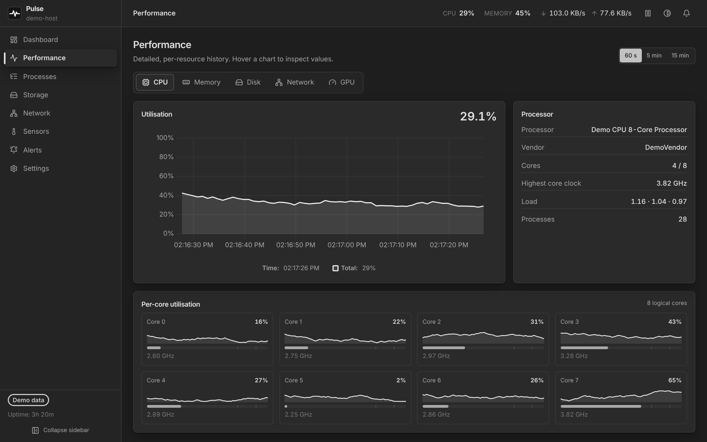                    |
| **Stockage**                                 | **Réglages de l'apparence**                                          |
| 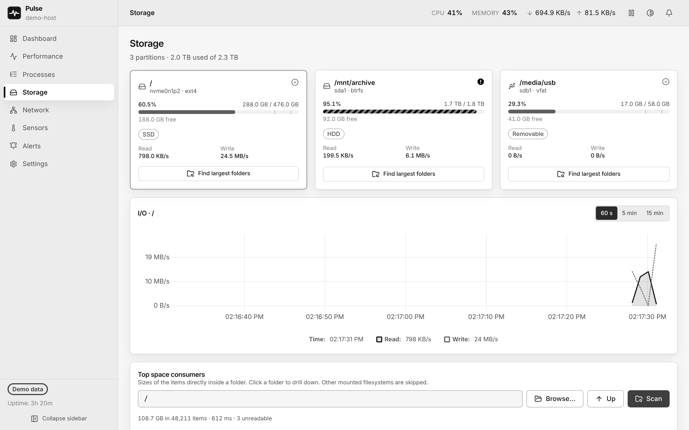    | 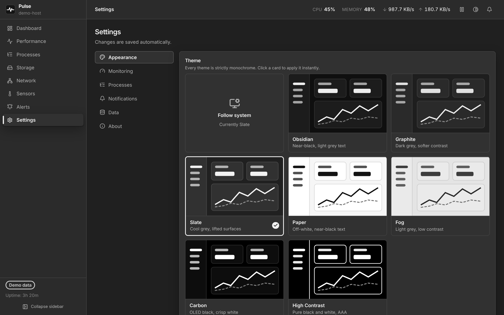 |

Pulse propose **sept thèmes en noir et blanc**, sombres et clairs, dont un thème
à fort contraste pour les personnes malvoyantes. Par défaut, il suit le mode
sombre ou clair de votre système.

| Obsidian                              | Graphite                              | Slate                                           | Paper                           |
| ------------------------------------- | ------------------------------------- | ----------------------------------------------- | ------------------------------- |
| 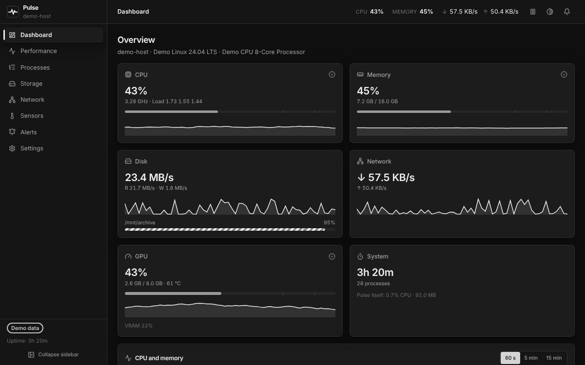 | 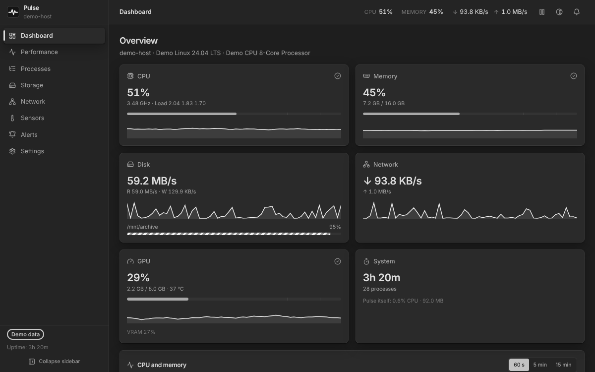 | 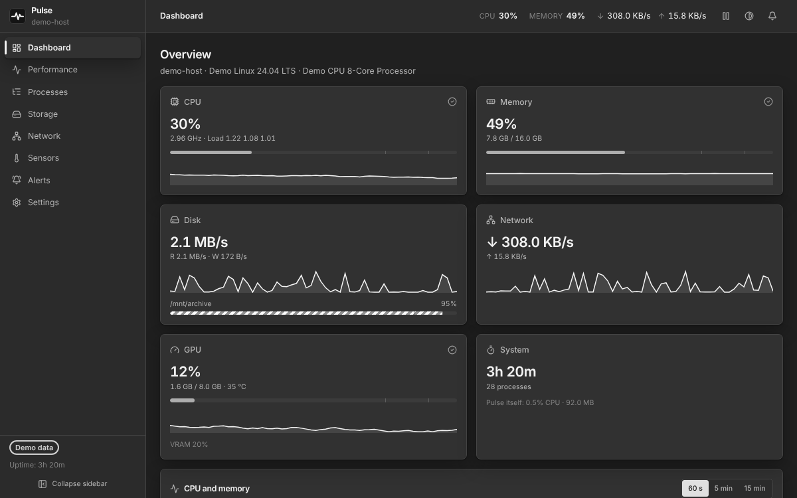                 | 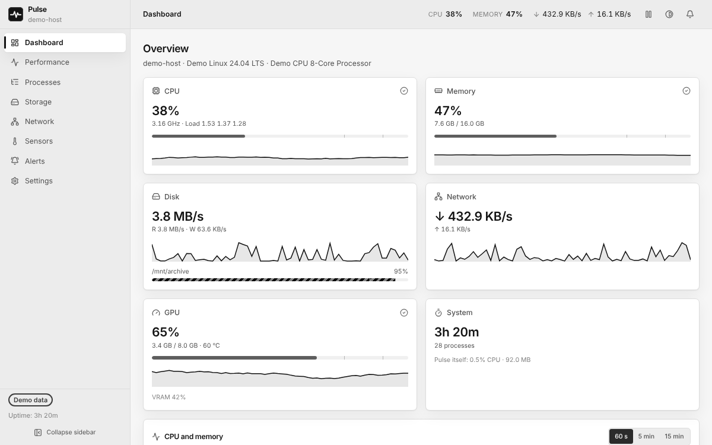 |
| **Fog**                               | **Carbon**                            | **High Contrast**                               |                                 |
| 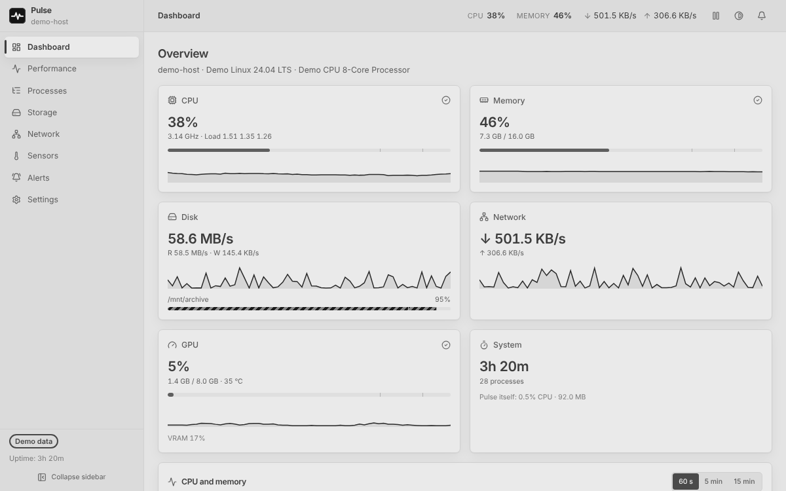           | 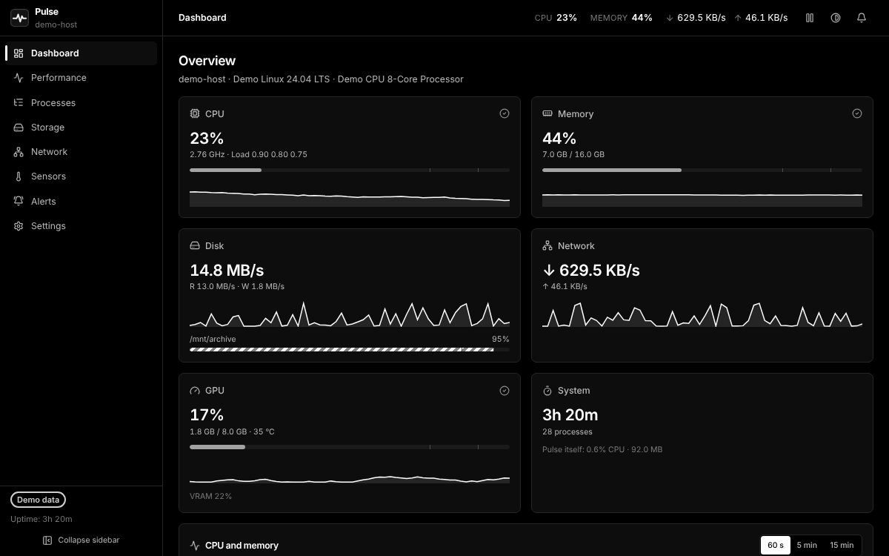     | 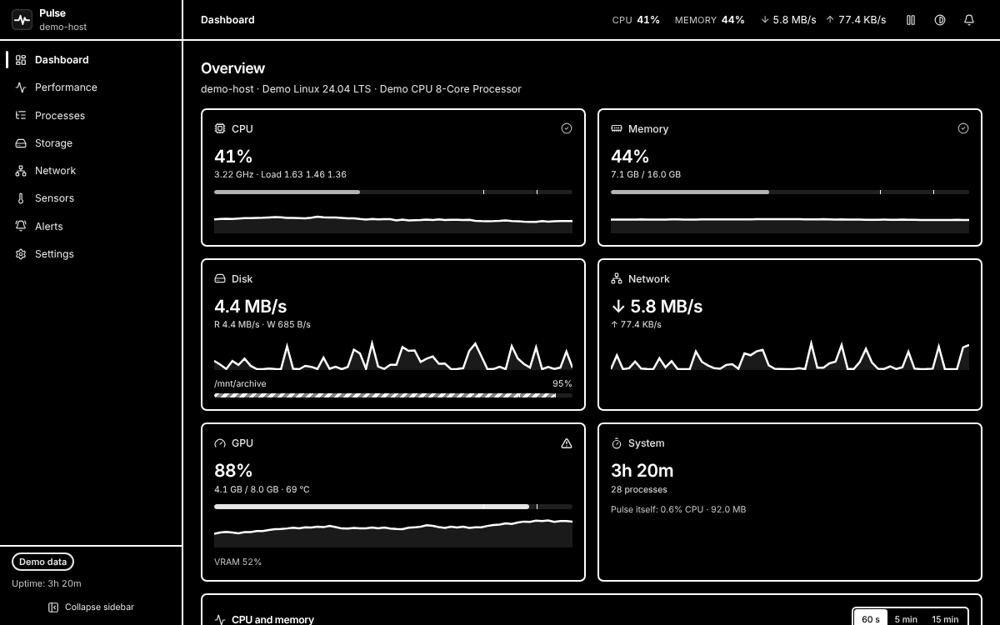 |                                 |

## Questions fréquentes

**Pourquoi je ne peux pas fermer certains programmes ?**
Les programmes qui appartiennent au système ou à un autre utilisateur sont
protégés. Pour les gérer, lancez Pulse en administrateur (Windows) ou avec
`sudo pulse` (Linux). Pulse vous l'indique clairement quand c'est le cas.

**Pourquoi je ne vois pas les températures sous Windows ?**
Windows ne les partage pas avec les applications ordinaires. Installez le
logiciel gratuit [LibreHardwareMonitor](https://github.com/LibreHardwareMonitor/LibreHardwareMonitor),
lancez-le en administrateur, et Pulse affichera ses mesures automatiquement.

**Est-ce que Pulse ralentit mon ordinateur ?**
Non. Quand il tourne en arrière-plan, il utilise moins de 1 % d'un cœur du
processeur et environ 100 Mo de mémoire.

**Est-ce que Pulse envoie mes données quelque part ?**
Non. Pulse ne se connecte jamais à internet. Seule exception : le bouton
« Vérifier les mises à jour » dans _Paramètres → À propos_, désactivé par défaut.

**Je ne vois pas l'icône de Pulse près de l'horloge (Linux).**
Certains bureaux, comme GNOME (celui d'Ubuntu), ont besoin de l'extension
_AppIndicator_ pour afficher ces icônes. Sans elle, Pulse fonctionne normalement ;
fermer la fenêtre quitte simplement l'application.

## Pour les développeurs

Pulse est écrit en Rust avec [Tauri 2](https://tauri.app) pour la partie système,
et en React avec TypeScript pour l'interface.

```bash
git clone https://github.com/tfem1/pulse.git
```

```bash
cd pulse
```

```bash
npm ci
```

```bash
npm run tauri dev
```

- [CONTRIBUTING.md](CONTRIBUTING.md) : prérequis, tests, règles de code et
  publication d'une version (en anglais).
- [docs/ARCHITECTURE.md](docs/ARCHITECTURE.md) : le fonctionnement interne
  (en anglais).
- [CHANGELOG.md](CHANGELOG.md) : l'historique des changements.

## Licence

[MIT](LICENSE) : libre d'utiliser, de modifier et de partager.
