<div align="center">


# Pulse

**A fast, monochrome system monitor for Linux and Windows.**

[](https://github.com/tfem1/pulse/actions/workflows/build.yml)
[](https://github.com/tfem1/pulse/releases)
[](LICENSE)


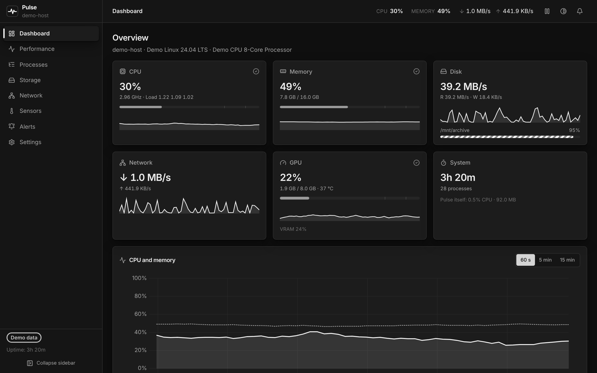

</div>

Pulse aims to beat Windows Task Manager and match GNOME System Monitor and htop.
It has a modern, keyboard-friendly interface and runs from a single
Rust + Tauri codebase. It is a native app with a small binary that uses the
system webview, has no telemetry, and makes no network calls unless you opt in.

## Features

- **Dashboard** — CPU, memory, disk, network, GPU and system cards with
  sparklines, a live CPU/memory chart and the top processes.
- **Performance** — tabs for CPU (per core, frequencies, load average), Memory
  (composition, cache, commit, swap), Disk, Network and GPU. Each tab has a
  rolling chart over 60 s, 5 min or 15 min.
- **Process manager**:
  - a virtualised table that stays smooth with thousands of rows, with sort,
    instant search (`/`) and a **tree view**;
  - a greyscale CPU, memory and disk heat-map;
  - **End task** (graceful), **Force kill**, **Suspend / Resume** and
    **Priority**, with confirmation dialogs and precise permission errors;
  - full keyboard control (↑ ↓ · Enter · Del · Shift+Del) and a context menu.
- **Storage** — per-partition usage and live read/write speeds, plus a bounded
  **top space consumers** scanner you can drill into.
- **Network** — per-interface throughput, addresses, link speed, MTU and error
  counters, TCP connection states and listening sockets (with the owning PID
  on Windows).
- **Sensors** — temperatures, fans, voltages, power and current, with
  session min/max, critical thresholds and trends.
- **Alerts** — rules on CPU, memory, swap, disk space, I/O, network, GPU and
  temperatures, with a minimum duration and cooldown. They are evaluated in the
  backend even when the window is hidden, and send **desktop notifications**,
  respecting quiet hours.
- **Tray icon** — live CPU, memory and network figures; close-to-tray; Quit.
- **Export** — the full metrics history to **CSV** or **JSON**.
- **Seven monochrome themes**, a follow-system mode, accent intensity,
  comfortable or compact density, and an **English / French** UI.
- **Accessible** — visible focus rings in every theme, a skip link, ARIA
  roles, and status conveyed by shape rather than colour.

### Why it beats Task Manager

|                                     | Task Manager         | Pulse                                               |
| ----------------------------------- | -------------------- | --------------------------------------------------- |
| Linux support                       | ✗                    | ✓                                                   |
| Process tree view                   | ✗ (grouped only)     | ✓                                                   |
| Suspend / resume a process          | ✗                    | ✓                                                   |
| Alert rules with notifications      | ✗                    | ✓                                                   |
| Export metrics (CSV/JSON)           | ✗                    | ✓                                                   |
| Selectable history window           | 60 s fixed           | 60 s / 5 min / 15 min (up to 60 min of history)     |
| Temperatures, fans, voltages        | GPU temperature only | All sensors exposed by hwmon / LibreHardwareMonitor |
| Open sockets / listening ports      | ✗ (Resource Monitor) | ✓                                                   |
| Largest folders on a disk           | ✗                    | ✓                                                   |
| Shows its own CPU & memory overhead | ✗                    | ✓                                                   |

## Screenshots

| Processes                                    | Performance                                                      |
| -------------------------------------------- | ---------------------------------------------------------------- |
| 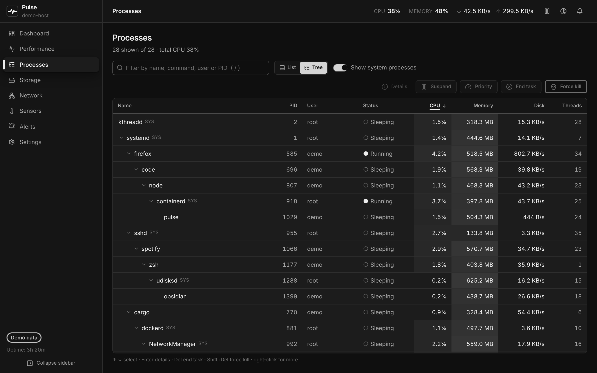 | 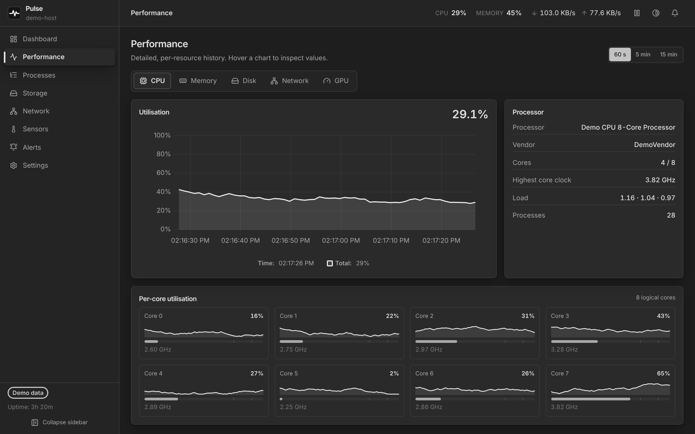                 |
| **Storage**                                  | **Settings → Appearance**                                        |
| 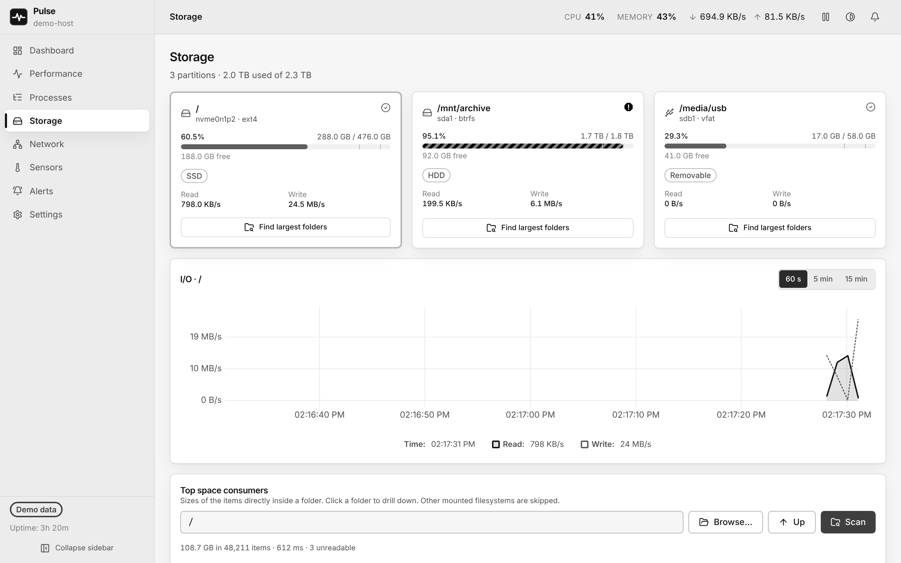     | 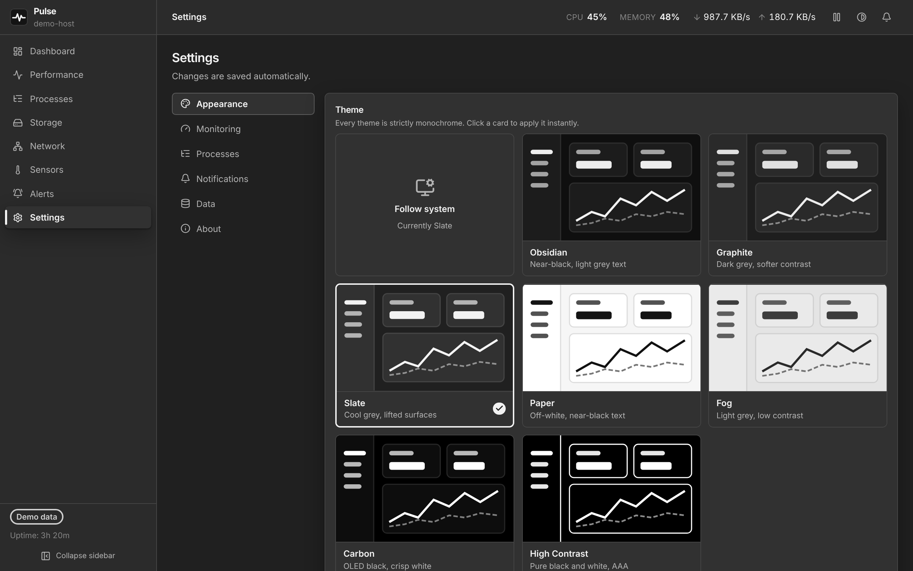 |

> These screenshots were taken with the browser demo backend (`npm run dev`),
> so the values are synthetic.

## Themes

Every theme is strictly greyscale: all colours have R = G = B, which the test
suite enforces. State is conveyed by lightness, stroke weight, pattern and
shape — never by hue.

|                                                                                                                                       |                                                                                    |                                                                           |
| ------------------------------------------------------------------------------------------------------------------------------------- | ---------------------------------------------------------------------------------- | ------------------------------------------------------------------------- |
| 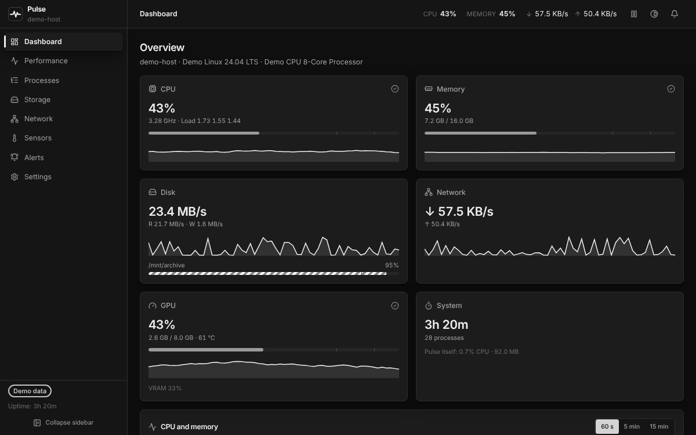<br>**Obsidian** — near-black, light grey text (default dark)                                    | 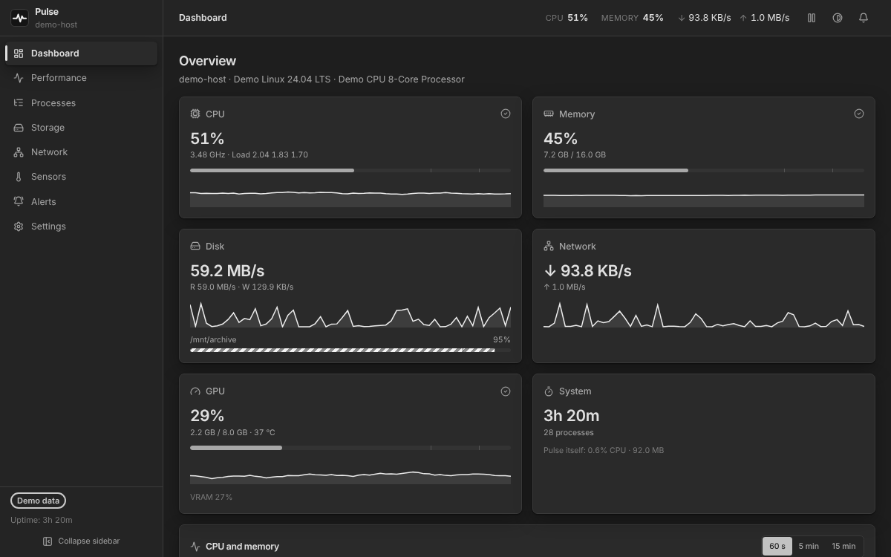<br>**Graphite** — dark grey, softer contrast | 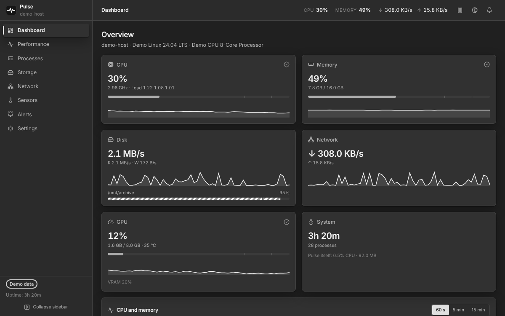<br>**Slate** — cooler, lifted surfaces    |
| 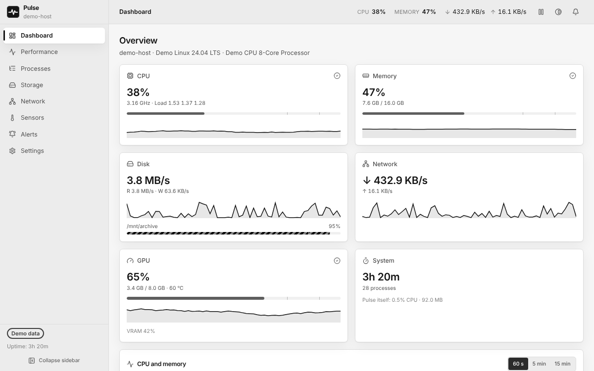<br>**Paper** — off-white, near-black text (light)                                                     | 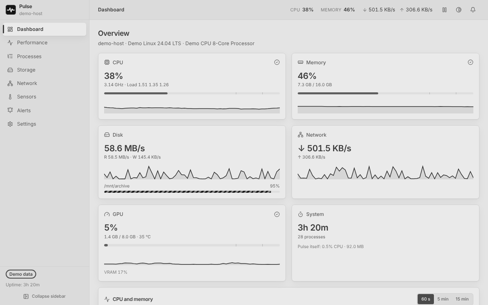<br>**Fog** — light grey, low contrast                  | 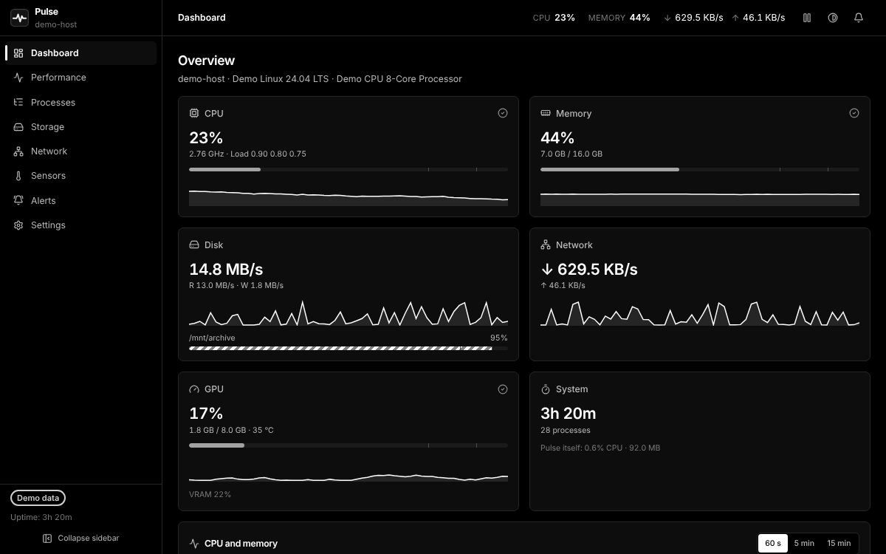<br>**Carbon** — OLED black, crisp white |
| 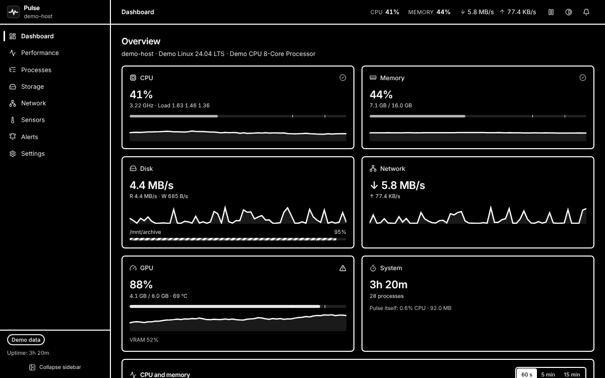<br>**High Contrast** — pure black and white, 2 px borders, 4 px focus rings, WCAG AAA |                                                                                    |                                                                           |

Choose **Follow system** to switch between a dark and a light theme of your
choice with the OS setting.

## Install

Download the latest installer from the
[Releases page](https://github.com/tfem1/pulse/releases).

### Linux

- **Debian / Ubuntu** — install the `.deb`:

  ```bash
  sudo apt install ./Pulse_*_amd64.deb
  ```

- **Any distribution** — use the AppImage:

  ```bash
  chmod +x Pulse_*_amd64.AppImage
  ./Pulse_*_amd64.AppImage
  ```

The tray icon needs an AppIndicator / StatusNotifier host. KDE, Cinnamon and
Xfce include one; on GNOME install the _AppIndicator and KStatusNotifierItem
Support_ extension. Without a host, Pulse still runs, and closing the window
quits it.

To manage other users' processes, raise priorities or read some sensors, run
Pulse with elevated rights (for example `sudo -E pulse`), or grant
`CAP_SYS_NICE` / `CAP_KILL` to the binary.

### Windows

Run the `.msi` or `Pulse_*_x64-setup.exe` installer. Windows 10 and 11 already
include WebView2; the installer downloads it otherwise.

Windows does not expose temperatures, fans or voltages to regular
applications. Install and run [LibreHardwareMonitor](https://github.com/LibreHardwareMonitor/LibreHardwareMonitor)
(as administrator) and Pulse reads its sensors automatically. Without it, Pulse
falls back to ACPI thermal zones, which also need administrator rights.

## Build from source

Prerequisites:

- Rust stable 1.82 or newer ([rustup](https://rustup.rs))
- Node.js 20 or newer
- **Linux:**

  ```bash
  sudo apt-get install -y libwebkit2gtk-4.1-dev build-essential file libxdo-dev libssl-dev libayatana-appindicator3-dev librsvg2-dev
  ```

- **Windows:** [Microsoft C++ Build Tools](https://visualstudio.microsoft.com/visual-cpp-build-tools/) and WebView2.

Then:

```bash
git clone https://github.com/tfem1/pulse.git
```

```bash
cd pulse
```

```bash
npm ci
```

Run in development mode with hot reload:

```bash
npm run tauri dev
```

Build the installers for your OS into `target/release/bundle/`:

```bash
npm run tauri build
```

With [`just`](https://github.com/casey/just) installed you can use the shortcuts
`just dev`, `just build`, `just test`, `just lint`, `just format` and
`just release <version>`.

## Architecture

```
React UI (webview) ──invoke──▶ Tauri commands ──▶ pulse-core (platform layer, alerts, export)
       ▲                                                     ▲
       └──── pulse://snapshot events ◀── sampler thread ─────┘  (sysinfo · NVML · hwmon · WMI)
```

- **`crates/pulse-core`** — a Tauri-free engine with the typed models, sampler,
  history ring buffer, alert engine, CSV/JSON export, directory scanner and a
  platform abstraction layer behind `#[cfg(target_os)]`
  (`platform/linux.rs`, `platform/windows.rs`). It is unit-tested, and its
  Windows code is type-checked from Linux in CI.
- **`src-tauri`** — the desktop shell: IPC commands, the background sampler
  thread, the tray, notifications and close-to-tray.
- **`src`** — the React UI:
  - routing with react-router, one page per section, and nested routes for the
    settings tabs;
  - Zustand stores;
  - uPlot charts updated imperatively, so a tick never re-renders a chart;
  - shadcn/ui components on Tailwind, themed entirely through CSS custom
    properties.

The data flow, the platform layer, routing and the theme token system are
documented in **[docs/ARCHITECTURE.md](docs/ARCHITECTURE.md)**.

## Performance

Measured on a 4-core VM (Linux, release build, 1 s refresh):

- **Closed to the tray** — sampling, alert evaluation and tray updates cost
  **0.16 % of one core** and **107 MB** in total (PSS). The webview is destroyed
  while hidden and re-created instantly from the tray.
- **Window open on the dashboard** — the Rust engine uses about 1 % of one core.
  The webview's cost depends on your GPU; it was 7 % of one core in a VM with no
  GPU and software rendering, the worst case.

Details and methodology: [docs/ARCHITECTURE.md](docs/ARCHITECTURE.md#keeping-idle-cost-low).

## Privacy

Pulse has no telemetry, no analytics and no crash reporting. The only network
request it can make is the optional update check (Settings → About), which is
**off by default** and only queries the GitHub Releases API when you click
_Check now_.

## Contributing

See [CONTRIBUTING.md](CONTRIBUTING.md) and the [Code of Conduct](CODE_OF_CONDUCT.md).
Changes are tracked in [CHANGELOG.md](CHANGELOG.md).

## License

[MIT](LICENSE)
