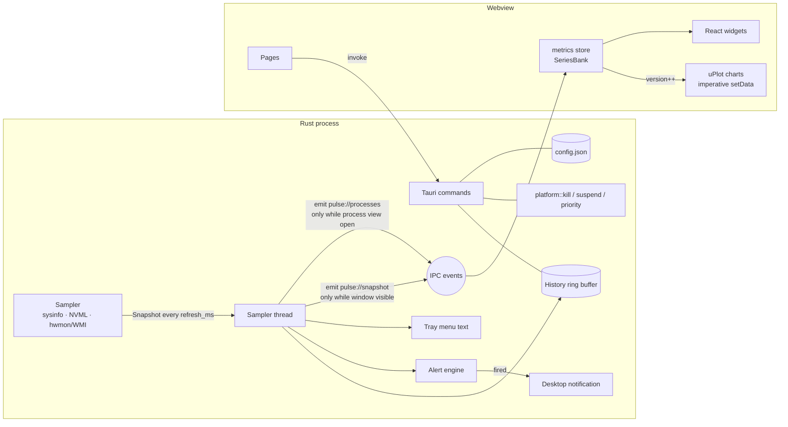

# Pulse architecture

Pulse is a Tauri v2 desktop application: a Rust process that samples the
machine, and a React UI rendered by the operating system's webview (WebKitGTK on
Linux, WebView2 on Windows). This document explains how data flows between
them, how platform differences are isolated, how the UI is routed, and how the
monochrome theme system works.

```
pulse/
├── crates/pulse-core/       Tauri-free engine: models, sampler, platform layer,
│   └── src/                 history, alerts, export, directory scanner
│       └── platform/        linux.rs · windows.rs · unix_proc.rs · fallback.rs
├── src-tauri/               Desktop shell: commands, sampler thread, tray
├── src/                     React + TypeScript UI
│   ├── app/                 bootstrap, router, navigation map
│   ├── components/          ui/ (shadcn), layout/, charts/, shared widgets
│   ├── pages/               one folder/file per route, settings/ sub-tabs
│   ├── stores/              Zustand stores (metrics, processes, config, …)
│   ├── lib/                 IPC client, types, formatting, ring buffers
│   ├── i18n/                en.ts (source of truth), fr.ts
│   ├── theme/               theme catalogue, provider, palette hook
│   └── styles/              themes.css (tokens), index.css
└── docs/
```

## 1. Data flow



### The sampler thread (`src-tauri/src/worker.rs`)

A single OS thread owns the `pulse_core::sampler::Sampler`. It must be one
thread: on Windows the sensor backend holds a COM/WMI connection, which is
thread-bound (`WMIConnection` is `!Send`). Each tick it:

1. collects a `Snapshot` (CPU, memory, disks, networks, GPUs, sensors);
2. appends a compact `HistoryPoint` to the ring buffer (capacity =
   `history_minutes × 60 000 / refresh_ms`);
3. evaluates the alert rules and sends desktop notifications (respecting
   quiet hours);
4. refreshes the tray menu (every second tick);
5. emits `pulse://snapshot` — **only when the main window is visible**.

Ticks are scheduled against a deadline (`next += interval`), so sampling cost
does not make the cadence drift. The loop waits on a channel with
`recv_timeout`, which lets commands wake it early: `ConfigChanged` (new
interval or history size), `SampleNow` (the process page just opened) and
`Shutdown`.

### Keeping idle cost low

The non-functional target is under 2 % CPU and under 150 MB. The biggest costs
and how they are contained:

| Cost                                                                    | Mitigation                                                                                                                                                                                                                                                          |
| ----------------------------------------------------------------------- | ------------------------------------------------------------------------------------------------------------------------------------------------------------------------------------------------------------------------------------------------------------------- |
| Full process table refresh (hundreds of `/proc` reads or NtQuery calls) | Only while a view that needs it is mounted (`set_process_streaming`, reference-counted in `stores/processes.ts`). Otherwise only Pulse's own process is refreshed, plus a cheap list refresh every 5 s for the process count.                                       |
| Disk / interface list discovery                                         | Every 30 s; counters every tick.                                                                                                                                                                                                                                    |
| Sensors                                                                 | Every `sensor_every` ticks; hwmon file paths discovered once a minute and cached.                                                                                                                                                                                   |
| sysinfo's Linux GPU refresh reloads NVML each call                      | Pulse keeps its own NVML handle and only refreshes sysinfo's GPU list when non-NVIDIA GPUs exist.                                                                                                                                                                   |
| IPC + rendering                                                         | No events while the window is hidden or minimised. Charts never trigger React renders: they subscribe to the store's `version` and call `uPlot.setData`. Hidden tabs are unmounted.                                                                                 |
| Process table DOM                                                       | Virtualised; only visible rows exist.                                                                                                                                                                                                                               |
| CSS animations on live values                                           | None: a 300 ms width transition on meters forced ~20 relayouts/s; removing it cut main-thread work on the dashboard by two-thirds.                                                                                                                                  |
| The webview itself while in the tray                                    | **Destroyed** on close-to-tray (`WindowEvent::CloseRequested` lets the window close; `RunEvent::ExitRequested { code: None }` is vetoed). The tray / a second launch re-creates it from `tauri.conf.json`, and the UI re-seeds its charts from the backend history. |

Measured on a 4-core Xeon VM (Linux, release build, 1 s refresh, software
rendering under Xvfb, 60 s windows):

| State                                                  | Pulse process CPU  | WebKit process CPU | Memory (PSS, all processes) |
| ------------------------------------------------------ | ------------------ | ------------------ | --------------------------- |
| Closed to tray (sampling, alerts, tray stats)          | 0.16 % of one core | — (no webview)     | **107 MB**                  |
| Dashboard visible, `WEBKIT_DISABLE_COMPOSITING_MODE=1` | 1.1 % of one core  | 6.8 % of one core  | 244 MB                      |
| Dashboard visible, software-GL compositing             | 1.1 % of one core  | 19.6 % of one core | —                           |

On a GPU-accelerated desktop the webview cost is far lower than in this
software-rendered environment.

### Frontend data model (`src/stores/metrics.ts`)

- `snapshot` — the latest sample, driving numeric widgets (one React render per
  tick on the visible page).
- `bank: SeriesBank` — mutable, allocation-free ring buffers (`Float64Array`)
  sharing one time axis. Keys: `cpu`, `core3`, `mem`, `if:eth0:rx`,
  `disk:/:r`, `sensor:hwmon2/temp1`, … `bank.window(keys, seconds)` returns
  uPlot `AlignedData` for any subset. At startup the bank is seeded with the
  backend history so charts are full immediately.
- `version` — incremented per tick; charts and sparklines subscribe to it.
- `paused` — freezes the display while the bank keeps recording.

## 2. Platform abstraction layer

`crates/pulse-core` has no Tauri dependency. It can therefore be unit-tested
headless, and **type-checked for Windows from a Linux machine**:

```bash
cargo clippy -p pulse-core --all-targets --target x86_64-pc-windows-msvc
```

`sysinfo` covers the cross-platform basics (CPU, memory, disks, networks,
processes, users, components, and GPUs for non-NVIDIA cards). Everything else
lives in `platform/`, behind one API in `platform/mod.rs`:

| Function                             | Linux (`linux.rs`, `unix_proc.rs`)                                                                    | Windows (`windows.rs`)                                                                                        |
| ------------------------------------ | ----------------------------------------------------------------------------------------------------- | ------------------------------------------------------------------------------------------------------------- |
| `kill_process(pid, force)`           | `SIGTERM` / `SIGKILL`                                                                                 | graceful: `WM_CLOSE` to the process's visible windows (like `taskkill` without `/F`), else `TerminateProcess` |
| `suspend_process` / `resume_process` | `SIGSTOP` / `SIGCONT`                                                                                 | `SuspendThread` / `ResumeThread` on every thread (Toolhelp snapshot)                                          |
| `set_priority` / `get_priority`      | `setpriority` (nice −20…19) / `/proc/<pid>/stat`                                                      | `SetPriorityClass` / `GetPriorityClass`                                                                       |
| `memory_breakdown()`                 | `/proc/meminfo`                                                                                       | `GetPerformanceInfo`                                                                                          |
| `connections()`                      | `/proc/net/{tcp,tcp6,udp,udp6}`                                                                       | `GetExtendedTcpTable` / `GetExtendedUdpTable` (with owning PID)                                               |
| `SensorCollector`                    | `/sys/class/hwmon` (temp, fan, in, power, curr)                                                       | WMI: `ROOT\LibreHardwareMonitor` → `ROOT\OpenHardwareMonitor` → `ROOT\WMI MSAcpi_ThermalZoneTemperature`      |
| `is_virtual_interface`               | no `/sys/class/net/<if>/device` link                                                                  | name heuristics (vEthernet, Hyper-V, VPN, …)                                                                  |
| `request_close` (app "End task")     | `SIGTERM`                                                                                             | `WM_CLOSE` to the process's visible windows                                                                   |
| `is_running`                         | `/proc/<pid>/stat` state (zombies count as exited)                                                    | `GetExitCodeProcess == STILL_ACTIVE`                                                                          |
| Apps detection                       | `uses_gui_toolkit`: libxcb / libX11 / libwayland-client mapped in `/proc/<pid>/maps` (cached per PID) | `window_titles`: visible, unowned, non-tool top-level windows (`EnumWindows`)                                 |
| `is_elevated`                        | `geteuid() == 0`                                                                                      | token elevation                                                                                               |

Modules are selected with `#[cfg(target_os = "linux")]` /
`#[cfg(target_os = "windows")]`. `fallback.rs` keeps other targets compiling:
signals work on any Unix, and the rest reports `Unsupported`.

**Safety rails.** `platform/mod.rs` refuses to act on PID 0, on PID 1 (Unix), and on
Pulse itself. OS errors are mapped to `PulseError::{PermissionDenied, NotFound,
…}` with actionable messages ("Run Pulse as root…", "Run as administrator…").
They are serialised to the UI as `{ kind, message }`.

**Graceful degradation.** Every value a platform may lack is an `Option` in
the models (`temperature_c`, `load_avg`, `breakdown`, …). A disabled metric
family is `None` at the snapshot level (`disks: None`). The UI renders
`Unavailable` states rather than zeros. Missing NVIDIA drivers, missing hwmon,
or an absent LibreHardwareMonitor are logged at `info` level and explained in
the UI.

**Apps view.** The sampler flags user-facing processes (`gui`, plus the window
`title` on Windows). It excludes desktop-shell components and Pulse itself with
its webview children; ownership doesn't matter, so an app started with sudo is
still an app. `src/lib/apps.ts` groups them like Task Manager: each is traced up
through ancestors running the same executable to the app's root, the app is that
root plus its descendants, and an app started from another app is nested in it.
`pulse_core::apps::end_app` ends an app: it asks the window owners to close,
waits up to 5 s, then terminates the survivors. "Force end" terminates them at
once.

**Parsers are pure functions** with fixture tests: `parse_meminfo`,
`parse_proc_net`, `parse_hwmon(root)` and `parse_stat_nice`.

## 3. Routing

`src/app/router.tsx` uses `createBrowserRouter`. Tauri's asset resolver falls
back to `index.html` for unknown paths, so real paths such as `/processes`
survive a reload.

```
/                     → redirect /dashboard
/dashboard            DashboardPage
/performance?tab=cpu  PerformancePage (tabs: cpu · memory · disk · network · gpu)
/processes            ProcessesPage
/storage              StoragePage
/network              NetworkPage
/sensors              SensorsPage
/alerts               AlertsPage
/settings             SettingsLayout (sub-navigation + <Outlet/>)
  ├─ /settings/appearance
  ├─ /settings/monitoring
  ├─ /settings/processes
  ├─ /settings/notifications
  ├─ /settings/data
  └─ /settings/about
*                     NotFoundPage
```

`AppLayout` renders the collapsible `Sidebar`, the `TopBar` and an
`ErrorBoundary` around the page `<Outlet/>`. The boundary resets on navigation,
so a crashing view never takes down the shell. The performance tab is kept in the
query string, so it is linkable. Global shortcuts (`hooks/useHotkeys.ts`):
<kbd>Ctrl</kbd>+<kbd>1…8</kbd> pages, <kbd>Ctrl</kbd>+<kbd>B</kbd> sidebar,
<kbd>Ctrl</kbd>+<kbd>Shift</kbd>+<kbd>P</kbd> pause.

## 4. Theme token system

All colours are CSS custom properties defined in `src/styles/themes.css`, one
block per `[data-theme="…"]`:

| Token                                                                          | Purpose                                 |
| ------------------------------------------------------------------------------ | --------------------------------------- |
| `--bg`, `--bg-elevated`                                                        | app background; sidebar and top bar     |
| `--surface`, `--surface-hover`                                                 | cards, rows, inputs                     |
| `--border`, `--border-strong`                                                  | hairlines; emphasised outlines          |
| `--text`, `--text-muted`, `--text-faint`                                       | text hierarchy                          |
| `--accent`, `--on-accent`                                                      | primary actions (a grey) and their text |
| `--chart-1` … `--chart-5`, `--chart-grid`                                      | chart series and grid                   |
| `--success`, `--warning`, `--danger`                                           | status greys                            |
| `--focus`, `--ring-width`, `--ring-offset`, `--border-width`, `--chart-stroke` | accessibility geometry                  |

Tailwind maps these to utilities (`bg-surface`, `text-muted`, `border-border-strong`,
`bg-chart-3`, …) in `tailwind.config.ts`. Switching theme only changes an
attribute; no component re-renders for colour.

**Monochrome rules.** Every value is a pure grey (R = G = B). State is
conveyed without hue:

- **Status** — shape + lightness: circle-check (ok), triangle (warning), filled
  octagon (danger, the brightest/darkest grey).
- **Meters** — solid mid-grey → light grey → hatched fill for danger.
- **Chart series** — five distinguishable greys _plus_ dash patterns
  (solid, `6-3`, `2-3`, …) and stroke width.
- **Selection** — heavier borders, bold text and outlines.

**Enforcement.** `src/theme/themes.test.ts` parses the stylesheets and fails if:

- any colour literal is not grey;
- a theme misses a token;
- body text is below 7:1 or muted text below 4.5:1 against bg, surface and
  elevated surfaces (High Contrast: ≥ 15:1 and ≥ 7:1, AAA);
- a chart grey or status grey is below 3:1 against the surface;
- neighbouring chart greys are indistinguishable.

**Runtime.** `ThemeProvider` resolves `"system"` with
`prefers-color-scheme` (using a user-chosen dark/light pair). It writes
`data-theme`, `data-accent` and `data-density` on `<html>`. Preferences persist in
`localStorage` (`pulse.appearance`), and `public/theme-init.js` applies them
before the first paint, so there is no flash of the wrong theme. Charts read
colours through `usePalette()`, which re-reads the CSS variables whenever those
attributes change.

High Contrast additionally sets `--border-width: 2px`, `--ring-width: 4px` and
a thicker `--chart-stroke`. Focus rings are drawn from the same tokens for
every interactive element (`:focus-visible` in `index.css`).

## 5. Configuration and persistence

- **Backend config** (`config.json` in the platform config directory —
  `~/.config/dev.pulse.app/` or `%APPDATA%\dev.pulse.app\`): monitoring,
  processes, notifications, alert rules, update-check opt-in. Every field has a
  serde default; `Config::sanitized()` clamps values; writes are atomic
  (temp file + rename); a corrupt file is backed up and replaced by defaults.
- **Appearance** (theme, accent, density, language, sidebar) lives in
  `localStorage` so it applies before IPC is available.

## 6. Security and privacy

- The capability file (`src-tauri/capabilities/default.json`) grants only core
  events and window APIs, notifications, the save/open dialogs, and opening URLs
  or revealing a file.
- The webview has no network access (`connect-src 'self' ipc:`). The only
  network requests come from the Rust updater (`pulse-core/src/update.rs`),
  and only when the user clicks _Check for updates_ or has enabled the
  start-up check. There is no telemetry.
- **Updater**: `check_update` asks the GitHub Releases API
  (`PULSE_UPDATE_API` overrides the URL for tests) and picks the asset for the
  detected installation (NSIS setup, MSI, AppImage or `.deb`; dev builds and
  unknown layouts report why they cannot self-update). `install_update`
  re-resolves the asset itself (the UI never supplies a URL), streams it to a
  temporary file while emitting `pulse://update-progress`, verifies the
  SHA-256 digest GitHub publishes, then installs it: atomic rename of the
  AppImage, `pkexec apt-get install` for the `.deb`, or a detached script that
  runs the silent Windows installer after Pulse exits. Pulse then quits and the
  new version starts.
- Process actions go through the guarded platform API; the UI confirms
  destructive actions by default.
